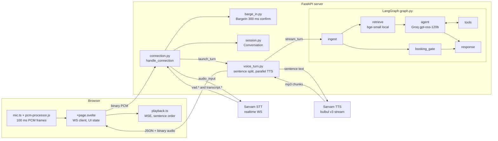
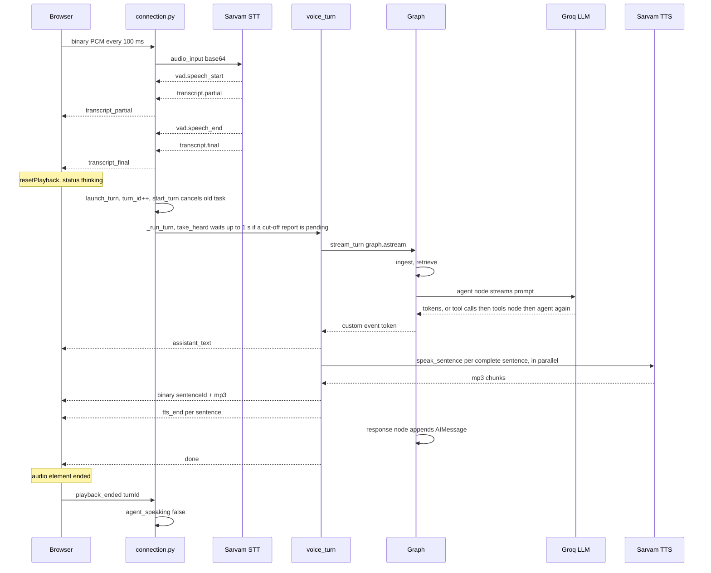
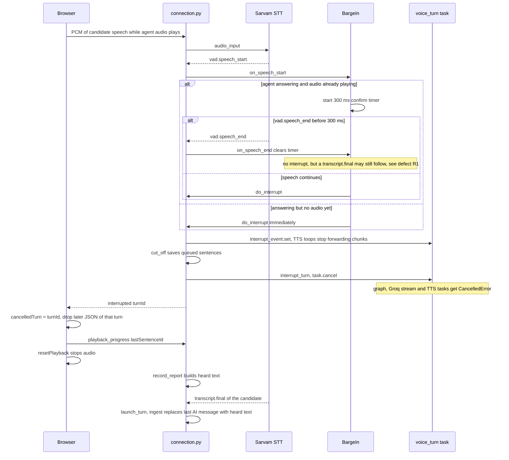
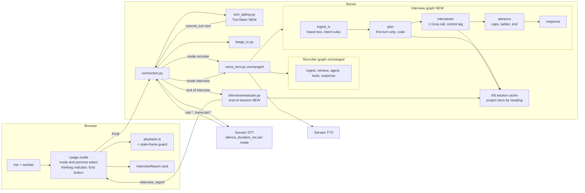
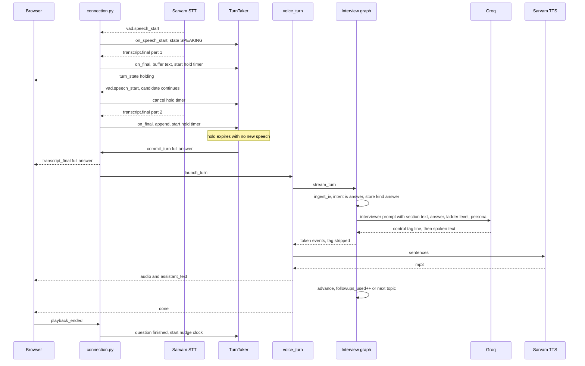
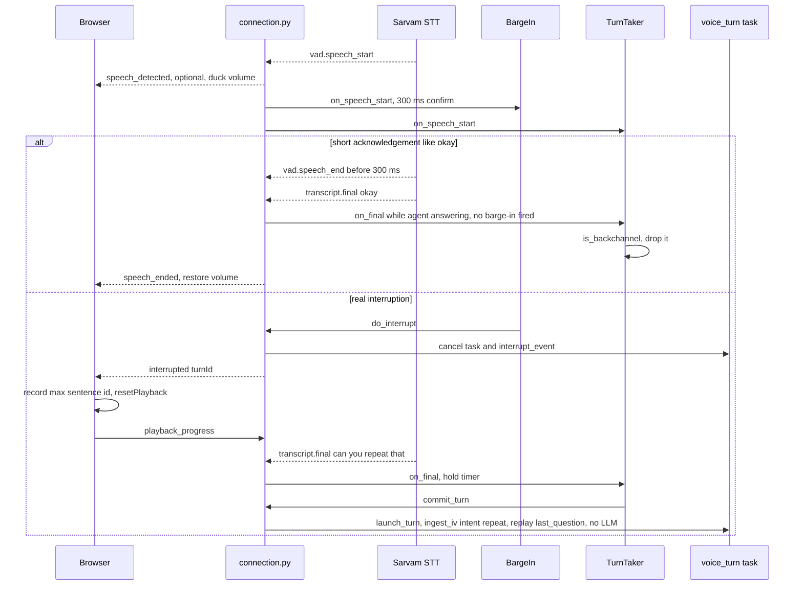
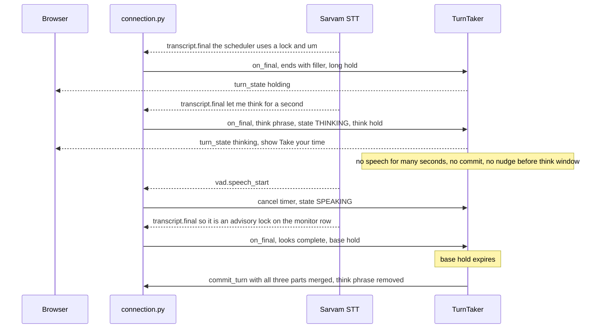
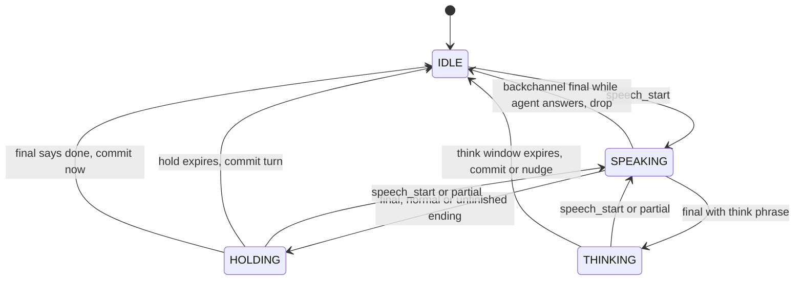

# Interviewer Mode: Audit, Design and Plan

**Repository:** `github.com/Arjun8242/voice-agent`, branch `main`, commit `73f8f1f` (2026-11-10, "Merge pull request #1 from Arjun8242/langgraph-part").
**Scope:** analysis and planning only. No repository files were changed. One throwaway probe test was run and then deleted; `git status` was clean afterwards.

How to read the evidence tags:

| Tag | Meaning |
|---|---|
| **[Verified]** | I read the code, or ran it, and it does this. |
| **[Ran]** | I executed it locally and observed the result. |
| **[Docs]** | The provider's official documentation says this. |
| **[Inferred]** | My reasoning from the code. Not reproduced. |
| **[Unverified]** | Not confirmed. Needs an experiment. |
| **[Assumption]** | A number I chose to make an estimate possible. |

---

## 1. Executive summary and recommendation

**What is real today.** You already have a working streaming voice loop with barge-in. Speech goes to Sarvam STT, a LangGraph agent answers, the answer is split into sentences, each sentence goes to Sarvam TTS, and the browser plays the audio. A barge-in cancels the running turn and remembers only what the listener heard. The test suite (94 tests) passes **[Ran]**.

**What is not real today.** The repo has no notion of "has the speaker finished their turn". The first `transcript.final` from Sarvam starts a turn immediately **[Verified]**. Sarvam's default end-of-speech silence is 500 ms **[Docs]**, and your code doesn't override it **[Verified]**. So any thinking pause longer than about half a second will make the interviewer jump in **[Inferred]**. That one gap would ruin an interview product.

**I also found a turn-taking bug that affects recruiter mode today [Ran].** A short "okay" spoken while the agent's audio plays is too short to trigger barge-in. But Sarvam still produces a final transcript for it, and that final:
- starts a new turn, which cancels the old one;
- makes the browser reset playback, which stops the audio;
- leaves the full answer in history, even though the listener didn't hear all of it.

**Your eight features collapse into four pieces of work:**

| Work item | Your features | Nature |
|---|---|---|
| A. Turn-taking controller | 5 Thinking time, 8 Silence detection, part of 2 | **Infrastructure, mandatory.** Pure code. No new paid usage. |
| B. Barge-in hardening | 2 Interruption, 3 Barge-in | Mostly done. Small fixes. No new paid usage. |
| C. Interviewer brain | 1 Natural voice, 4 Follow-ups, clarification part of 2, 7 Personalities | A new graph and prompts. Same LLM, roughly the same number of calls per turn. |
| D. Evaluation | 6 Adaptive difficulty | One extra LLM call per session (cheap). Self-scoring is unreliable. |

**Recommendation:**
- Build a **separate interview graph** that reuses your existing voice pipeline: `voice_turn`, TTS, barge-in and the connection.
- Put turn-taking in a **new, testable module outside the graph** (`backend/pipeline/turn_taking.py`), used by both modes.
- Ship an MVP with:
  - reliable turn-taking;
  - a grounded interviewer with bounded follow-ups;
  - deterministic clarification handling;
  - a fixed difficulty ladder (not LLM-scored adaptivity);
  - an end-of-session report;
  - one persona.

**Cost reality.** Per 10-minute interview, about 95% of the money is Sarvam voice: STT minutes plus TTS characters, roughly ₹12–14 in total. The LLM is under ₹1 (detailed in section 8). So the "smart" features, such as follow-ups, evaluation and personas, are almost free. **What costs money is minutes of audio and spoken characters.** Budget decisions should therefore cap interview length and interviewer verbosity, not drop the AI features.

---

## 2. Repository audit: verified current implementation

### 2.1 What I inspected

- **Tree and dependencies:** `backend/pyproject.toml`: FastAPI, websockets, httpx, groq, sentence-transformers, langgraph, pydantic. Python ≥ 3.12.
- **Configuration:** `backend/config.py`.
- **README.**
- **Frontend:** `web/src/lib/mic.ts`, `web/static/pcm-processor.js`, `web/src/lib/playback.ts`, `web/src/routes/+page.svelte`.
- **Backend:** `backend/server/*`, `backend/providers/*`, `backend/pipeline/*`, `backend/graph/**`, `backend/rag/*`, `backend/prompts/system.md`.
- **Tests:** `backend/tests/*` (9 files).
- **Knowledge base:** `knowledge_base/` sizes and the headings of `docs/projects/beacon.md`.

### 2.2 Component facts

| # | Claim | File / symbol | What the code does | Status |
|---|---|---|---|---|
| 1 | Mic capture is 100 ms PCM frames | `web/static/pcm-processor.js` `PcmProcessor`; `web/src/lib/mic.ts` `startMic` | Captures at 16 kHz with browser echo cancellation, noise suppression and AGC. Emits 1600-sample Int16 buffers. The page sends each one as a binary WebSocket frame. | [Verified] |
| 2 | STT endpoint | `backend/config.py` `SARVAM_STT_URL` | `wss://api.sarvam.ai/speech-to-text-realtime/ws?language_code=en-IN&model=saaras:v3-realtime&stream_type=fast`. No `silence_duration_ms`, `threshold` or `endpointing` parameters are set. | [Verified] |
| 3 | STT client | `backend/providers/stt.py` `SttClient` | Opens the socket lazily on the first audio. Sends `{"event":"audio_input","audio":<base64>}`. The queue holds 50 frames (`STT_QUEUE_MAX`); **when it is full, frames are silently dropped** (`except QueueFull: pass`). | [Verified] |
| 4 | STT events handled | `SttClient._reader` | Handles only `vad.speech_start`, `vad.speech_end`, `transcript.partial` and `transcript.final`. **Sarvam's `error` events and `session.end` (which carries the billed `audio_duration_s`) are ignored.** | [Verified] code, [Docs] event names |
| 5 | VAD events are distinct from finals | `connection.py` `_Handlers` | `on_speech_start` and `on_speech_end` feed barge-in and timing only. `on_final` is what starts a turn. | [Verified] |
| 6 | Turn start is immediate on a final | `connection.py` `_Handlers.on_final` → `launch_turn(text)` | Sends `transcript_final` to the browser, then launches the turn. There is no hold, merge or "is the speaker done?" logic. | [Verified] |
| 7 | One turn at a time | `session.py` `start_turn` | Cancels any in-flight turn task before storing the new one. Resets `agent_speaking` and `sentences`. | [Verified] |
| 8 | Turn pipeline | `pipeline/voice_turn.py` `voice_turn` | Streams graph events. On `token`, sends `assistant_text` and splits sentences with `pipeline/sentence.py` `extract_next_sentence`. Each sentence becomes its own `speak_sentence` task inside an `asyncio.TaskGroup`, so **TTS requests run in parallel**. A `tts_end` is always sent in `finally`. | [Verified] |
| 9 | TTS | `providers/tts.py` `stream_tts` | Streams a POST to `https://api.sarvam.ai/text-to-speech/stream` with `bulbul:v3`, speaker `suhani`, mp3 output. It checks `interrupt_event` before forwarding each chunk. | [Verified] |
| 10 | Audio framing | `voice_turn.speak_sentence` | Binary frame `[u32LE sentenceId][mp3 bytes]`. **Binary frames carry no `turnId`**; JSON frames do (`protocol.py` `with_turn_id`). | [Verified] |
| 11 | Sentence IDs | `session.py` `Conversation.sentence_counter` | Monotonic per connection, never reset per turn. | [Verified] |
| 12 | Browser playback | `web/src/lib/playback.ts` | MediaSource in `sequence` mode. Plays sentences strictly in ID order. `resetPlayback` clears everything and adopts the first ID it receives next. `currentSentenceId()` reports which sentence is playing. | [Verified] |
| 13 | Graph | `graph/graph.py` `build_graph` | `START → ingest → retrieve → agent ⇄ tools → response → END`, plus `booking_gate` for card clicks. Uses an `InMemorySaver` checkpointer, with `thread_id = session_id`. | [Verified] |
| 14 | LLM | `rag/llm.py` `stream_text` | Groq `openai/gpt-oss-120b`, streaming, `temperature=0.3`, `max_completion_tokens=512`, `reasoning_effort="low"`. Tool calls are accumulated and yielded at the end of the stream. | [Verified] |
| 15 | Tool loop cap | `graph/nodes/tools.py` `MAX_TOOL_STEPS` | Read by `after_agent`. The README says 4. | [Verified] (value per README) |
| 16 | Retrieval | `rag/retriever.py`, `graph/nodes/retrieve.py` | Local `bge-small` embeddings, `TOP_K=4`, a topic filter, and a fallback to no topic when nothing relevant is found. Retrieval has no API cost. | [Verified] |
| 17 | Heard-history after barge-in | `server/session.py` `cut_off`, `record_report`, `take_heard`; `graph/nodes/ingest.py` | Replaces the last AI message with only the sentences that were played, plus a "(the visitor interrupted here)" note. The next turn waits up to 1 s (`REPORT_WAIT_S`) for the browser's report. | [Verified] |
| 18 | Barge-in detector | `pipeline/barge_in.py` `BargeIn` | If the agent is answering but no audio has played yet, it interrupts immediately. If audio is playing, it waits `confirm_ms=300` and interrupts only if speech is still going. A `speech_end` before then cancels it. | [Verified] |
| 19 | Disconnect cleanup | `connection.py` `finally:` | Calls `barge_in.dispose()`, `stt.close()` (which cancels the STT task) and `interrupt_turn(conv)`. Booking tasks are deliberately left to finish. | [Verified] |
| 20 | Turn timing log | `observability/timings.py` | One JSON line per turn to `data/turn_log.jsonl` (gitignored), with p50/p95 reports. Interrupted turns are kept and flagged. | [Verified] |
| 21 | Knowledge base size | `knowledge_base/docs/projects/*.md` | Beacon 7.3 kB, FitAI 7.2 kB, Valyrian 7.8 kB, about 2k tokens each. Headings include Overview, Architecture, Key Engineering Decisions (as "Why…?" questions), Engineering Challenge, Limitations and Future Work, and Testing. | [Verified] |

### 2.3 Tests: what they actually cover

All 94 tests pass with fakes (fake WebSocket, fake STT, fake TTS, scripted model) **[Ran]**. I ran them on Python 3.13; your project targets 3.12.

| File | Covers | Does not cover |
|---|---|---|
| `test_voice_conversation.py` | 15 barge-in timelines through the real `handle_connection`: heard text, late cards, duplicate cut-ins, report timeouts, the turn log, session resume | Real Sarvam timing, the real browser, end-of-turn decisions, short acknowledgements |
| `test_spoken_answer.py` | Sentence splitting; `BargeIn` confirm and noise rejection, at the detector level only | The final-transcript path that bypasses `BargeIn` |
| `test_agent.py` | Tool loop, step cap, Groq streaming of tool calls | — |
| `test_booking.py`, `test_google_calendar.py` | Booking state machine, idempotency, timeouts | — |
| `test_knowledge_base.py`, `test_observability.py` | KB validation, redaction, timing report | — |

There are **no tests for the browser** (playback, mic).

### 2.4 Defects and risks found during the audit

| ID | Finding | Evidence | Impact on interviewer mode |
|---|---|---|---|
| R1 | **A short acknowledgement during playback cuts the answer and corrupts history.** "okay" is shorter than 300 ms, so `BargeIn` does nothing. Then `on_final("okay")` launches a turn. The browser's `transcript_final` handler calls `resetPlayback`, and history keeps the full answer as if it was heard. | Probe test **[Ran]**: no `interrupted` message, `transcript_final` contains `okay`, and the next prompt holds the full "First sentence. Second sentence." Browser reset: `+page.svelte` `case 'transcript_final'` **[Verified]** | High. Candidates say "mm", "right" and "okay" constantly. |
| R2 | **No end-of-turn logic.** A pause becomes a final, and the final becomes a turn. | `on_final` → `launch_turn` **[Verified]**; Sarvam default `silence_duration_ms` = 500 **[Docs]**; the repo doesn't set it **[Verified]** | Critical. The interviewer would talk over a thinking candidate. |
| R3 | **Barge-in is not immediate.** The browser only stops audio after the server's `interrupted` message. | `+page.svelte` `case 'interrupted'` → `resetPlayback` **[Verified]** | Medium. Expected delay is in §6.2. Unmeasured. |
| R4 | **A late audio frame from a cancelled turn could replay.** Binary frames carry no `turnId`, and after a reset the player adopts whatever ID arrives first. | `playback.ts` `appendChunk` with `expectedSentenceId === null` **[Verified]** | Low–medium. A race; **[Inferred]**, not reproduced. |
| R5 | Sarvam `error` and `session.end` are ignored. | `stt.py` `_reader` **[Verified]** | You can't see the billed audio seconds, and fatal STT errors fail silently. |
| R6 | A full STT queue silently drops audio. | `stt.py` `send_audio` **[Verified]** | Rare (it needs a 5 s backlog). Words are lost silently. |
| R7 | The recruiter prompt is persona-specific ("You are an AI voice assistant that speaks about Arjun…"). | `prompts/system.md` **[Verified]** | Interviewer mode needs its own prompt. Don't branch inside this one. |

---

## 3. Current architecture and dataflow

### 3.1 In plain language first

- **Browser.** Records your voice in small 100 ms pieces and sends them to the server. It also plays the reply audio, in sentence order.
- **Connection** (`server/connection.py`). One per open tab. It is the traffic controller. It forwards audio to STT, listens for STT events, starts and cancels turns, and handles barge-in.
- **STT** (Sarvam). Turns audio into text. It also has VAD (voice activity detection), which reports "someone started talking" and "someone stopped talking". **VAD is about sound, not meaning.**
- **Turn** (`pipeline/voice_turn.py`). One question-and-answer. It runs the graph, cuts the streamed answer into sentences, and sends each sentence to TTS as soon as it is complete.
- **Graph** (`graph/`). The agent's brain: record the message, retrieve knowledge, call the LLM (and tools if needed), save the reply to history.
- **TTS** (Sarvam). Turns each sentence into MP3, streamed back in chunks.
- **Session state** (`server/session.py` `Conversation`). Per-connection memory about speech: which turn is running, whether audio is playing, which sentences were queued, and what was heard after a cut-in.
- **Graph state** (`graph/state.py` `TurnState`, saved by the checkpointer). Per-session memory about the conversation: messages, topic, offered booking slots.
- **Cancellation.** A turn is an asyncio task. Cancelling it stops the graph, the LLM stream and any TTS still running, because they all run inside that task. `interrupt_event` additionally tells TTS loops to stop forwarding chunks.
- **Streaming.** Nothing waits for the whole answer. LLM tokens become sentences, sentences become TTS requests, TTS chunks become browser audio, all as soon as each piece is ready.

### 3.2 Current architecture



### 3.3 Current voice turn (verified order)



Note: the order of `vad.speech_end` and `transcript.final` is not guaranteed. The code comments say a final can arrive before its speech-end (`connection.py` `launch_turn`).

### 3.4 Current barge-in (verified order)



### 3.5 Six concepts that must stay separate

| Concept | Who decides today | Signal | What it should trigger |
|---|---|---|---|
| **Speech started** | Sarvam VAD | `vad.speech_start` | Barge-in check. Cancel any pending end-of-turn timer. |
| **Speech segment ended** | Sarvam VAD (after `silence_duration_ms`, default 500 ms [Docs]) | `vad.speech_end`, then `transcript.final` | Nothing final yet. It's only a candidate end of turn. |
| **Turn complete** | **Nobody.** Today the final transcript is treated as the end of the turn. | — | Start the interviewer's reply. |
| **Thinking** | Nobody | — | Hold the turn open for longer. Maybe a gentle nudge later. |
| **Cancel TTS playback** | Browser, on `interrupted` or `transcript_final` | `resetPlayback` | Stop sound now. |
| **Cancel LLM/graph turn** | Server | `task.cancel()` in `start_turn` / `interrupt_turn` | Stop generating and stop paying for TTS of unsent sentences. |

How they interact:
- A **speech start** during agent audio may become a **barge-in**, which triggers both cancellations.
- A **speech segment end** is only evidence. The **turn controller** combines it with text cues and timers to decide **turn complete** or **thinking**.
- Today, R1 happens because "segment ended with a final" is wired straight to "turn complete", which also cancels the old turn and its playback.

---

## 4. Feature-by-feature assessment

Difficulty is 1 (trivial) to 5 (hard). Cost impact is relative to recruiter mode today.

| Feature | Status | Evidence | What is missing | Backend changes | Frontend changes | STT/VAD/TTS/LLM changes | New state / events | External dependency | Difficulty | Recurring cost | Priority |
|---|---|---|---|---|---|---|---|---|---|---|---|
| 1 Natural voice | **Partial** | Sentence streaming in `voice_turn.py`; one voice, `suhani` | An interviewer prompt (short turns, acknowledgements, no lists). Natural turn timing (that's feature 5). | New `prompts/interviewer.md` | None | LLM prompt only | — | None new | 2 | None | P0, via the prompt |
| 2 Interruption + clarification | Interruption **partial**, clarification **missing** | `BargeIn`, heard-history; R1, R3, R4 | Ignore short acknowledgements; detect clarification intents; never grade them | `turn_taking.py` acknowledgement filter; `interview/intents.py` | Stale-audio guard (R4) | None | `turn_kind` in interview state | None | 2 | None | P0 |
| 3 Barge-in | **Partial** (works, not immediate) | §3.4; R3, R4 | Measured latency; optional local audio ducking | Optionally forward `speech_start` to the browser | Duck volume on `speech_detected`; drop stale frames | None | `speech_detected` message (optional) | None | 2 | None | P0 for R4, P1 for ducking |
| 4 Dynamic follow-ups | **Missing** | No interview logic exists | A topic plan, a follow-up decision, caps, grounding | Interview graph: plan, interviewer, advance nodes | Show the current topic (optional) | LLM: same model, same number of calls | `plan`, `topic_index`, `followups_used` | None | 3 | Low (about the same tokens per turn as recruiter mode) | P0 |
| 5 Thinking time | **Missing** | `on_final` → `launch_turn` immediately (R2) | An end-of-turn controller with hold timers and resume merging | `turn_taking.py`; `connection.py` wiring | "Take your time" indicator | **STT:** raise `silence_duration_ms` in interview mode [Docs]; experiment first | `pending_text`, `hold_deadline`, controller state | Sarvam params [Docs] | 3 | None (mic is open either way) | **P0** |
| 6 Adaptive difficulty | **Missing** | — | A difficulty definition; a signal; anti-oscillation | Deterministic ladder in `advance` node; optional rating tag | None | LLM: a few output tokens if tag-based | `difficulty`, `ratings` | None | 3 (to do it well) | None to low | **P2.** v1 uses a deterministic ladder |
| 7 Personalities | **Missing** | One prompt, one voice | Behaviour differences, not just adjectives | `interview/personas.py`; prompt fragments | Persona picker | TTS speaker is config only (`TTS_SPEAKER`). Same price per character [Docs] | `persona` in `session_start` | None | 1–2 | None | P2 (ship one persona) |
| 8 Silence detection | **Missing** (same root cause as 5) | — | Classify thinking vs done vs abandoned; nudges | Same controller; nudge templates | Nudge text and indicator | TTS characters for nudges | `nudges_given`, `last_question_ended_at` | None | 3 | Low (a few dozen characters per nudge) | P0 for the classification, P1 for nudges |

### 4.1 Specific questions

**A. Natural voice conversation.**
- Sentence-streamed TTS is necessary, but it isn't enough for natural conversation.
- What makes interviewers feel robotic, in order of impact:
  1. **Turn timing.** Jumping in during pauses (R2) or waiting too long.
  2. **Long, list-like turns.** Reading out three questions at once.
  3. **No acknowledgement** of what was said ("Right, so the outbox…").
  4. **Time to first audio.** Your turn log already measures `speech_end_to_first_audio_ms` [Verified].
  5. Prosody and voice, which you can't change cheaply.
- Improvements that cost nothing extra:
  - a prompt that forces one question per turn of at most 2 sentences, starting with a short acknowledgement that references a specific phrase from the answer;
  - the turn-taking controller;
  - avoiding the first sentence being very long. The splitter only cuts at `.`, `!` or `?` (`sentence.py`), so the prompt should favour a short first sentence.
- Shorter interviewer turns also **reduce TTS cost** (section 8).

**B. Real-time interruption and barge-in.**
- **Is it immediate?** No. The expected chain is:
  1. Sarvam detects speech. It needs at least `min_speech_duration_ms`, default 250 ms [Docs]; whether `vad.speech_start` fires before or after that minimum is [Unverified].
  2. 100 ms of audio buffering in the worklet.
  3. Network to the server, then to Sarvam and back.
  4. The `BargeIn` 300 ms confirm (`barge_in.py` `confirm_ms=300`).
  5. Network back to the browser.
  6. `resetPlayback`.

  A rough expectation is 0.5–1 s [Inferred], **not measured**. Measure it in Phase 0.
- **Audio already queued in the browser** is discarded by `resetPlayback`, which recreates the MediaSource [Verified].
- **In-flight LLM, graph and TTS work** is cancelled by `task.cancel()` [Verified]. Whether Groq bills tokens generated before the stream closed, and whether Sarvam bills the full text of a cancelled TTS request, is [Unverified]. Assume yes.
- **Stopping the old answer from continuing:**
  - JSON messages: the browser drops anything with `turnId <= cancelledTurn` [Verified].
  - Audio frames have no turn ID (R4). Fix it in the browser: at an interrupt, record the highest sentence ID seen, and after a reset ignore frames with an ID at or below it. Sentence IDs are monotonic per connection [Verified], so this needs no protocol change.
- **Noise vs cough vs acknowledgement vs real interruption.** Use layers:
  1. Browser echo cancellation and noise suppression (already on) [Verified].
  2. Sarvam `threshold` and `min_speech_duration_ms` [Docs].
  3. `BargeIn` 300 ms confirm [Verified].
  4. **New:** a transcript-level check. A final that is a short acknowledgement ("okay", "mm-hmm", "right", "yeah"), arriving while the agent is answering and not preceded by a barge-in, is **dropped**, not turned into a turn. This fixes R1.
  5. A cough produces either no final, or an empty or junk final. The existing `if not text: continue` handles the empty case [Verified].
- **Race conditions to test** (scripted in the `Harness` style; see section 7):
  - an interrupt during a tool call (already tested, timeline 3);
  - a final arriving while the next turn waits for a playback report (timeline 12);
  - an acknowledgement final during playback (R1, untested);
  - a late audio frame after `interrupted` (R4, untested);
  - speech starting at the moment the end-of-turn timer fires (new).

**C. Clarification.**
- Use **both deterministic rules and the LLM, with rules first**:
  - **"Repeat that" / "say again" / "pardon"** → replay `last_question` from state. No LLM call, only TTS characters.
  - **"Can I get a hint" / "give me a hint"** → an LLM call with instruction `mode=hint`. The hint comes from the plan's KB section.
  - **"What do you mean" / "clarify" / "which part"** → an LLM call with `mode=rephrase`.
  - **Anything else** → treated as an answer. The interviewer prompt may still decide it was a clarification and say so in its control tag (see E).
- **Never grade a clarification.** Every candidate utterance stored for the evaluator carries `kind ∈ {answer, clarify, hint_request, repeat, think, skip}`. The evaluator only receives `kind=answer`. This is enforced in code, not left to the prompt.

**D. Thinking time and silence detection.** See section 6.1 for the full controller.
- **The core problem:** a timer alone is wrong in both directions.
  - Too short, and it interrupts a thinker.
  - Too long, and every answer ends with dead air.
  - Silence length alone also can't tell "I'm done" from "so the reason is… [thinking]".
- **The simplest robust design** combines three signals:
  1. **Provider VAD** produces speech segments.
  2. **Text cues** in the latest final: an unfinished ending ("and", "so", "because", "um") means "not done"; an explicit "let me think" or "give me a moment" means thinking; "that's it" or "I'm done" means done.
  3. **A mode-specific hold timer** after each final, cancelled by any new speech.

**E. Dynamic follow-ups.**
- **Decision options:** `probe` (go deeper), `example` (ask for a concrete case), `challenge` (question a decision), `next` (move on), `clarify_back` (the answer was unclear).
- **Who decides:** the LLM chooses, within bounds set by code:
  - at most 2 follow-ups per topic;
  - a total turn budget;
  - `challenge` only at difficulty level 3 or with the "tough" persona.
- **Grounding:** each topic in the plan is a KB section ID. The interviewer receives **the full text of that project section** (about 2k tokens per project doc, §2.2 row 21) plus a rule: "Ask only about things in this text, or about what the candidate just said. Never state facts that are not in this text."
- **Use a prepared plan with cached section text, not per-turn vector retrieval.** Your knowledge base is small enough that the whole relevant section fits in the prompt. Vector search would add failure modes (wrong chunk) without benefit here. `retrieval-design.md` is **not needed** for interviewer mode.
- **Bounding:** code moves to the next topic when `followups_used == 2`, or when the candidate says "I don't know" or "skip". Code ends the interview at the plan end or the time cap, whichever comes first.

**F. Adaptive difficulty.**
- **Operational definition:**
  - **L1 Explain** ("what does the scheduler do?");
  - **L2 Justify** ("why Postgres and not Redis for the queue?");
  - **L3 Stress** ("what breaks with two schedulers / at 10× load / if the outbox worker dies?").
- These map naturally onto your KB headings: Overview/Architecture → L1, Key Engineering Decisions → L2, Engineering Challenge / Limitations → L3.
- **Is an LLM self-score reliable?** Not reliable enough to steer without guards. It is lenient and inconsistent, and it is uncalibrated against your own judgement [Inferred from general LLM-judge behaviour; you would measure this in Phase 4].

| Option | Cost | Latency | Reliability | Verdict |
|---|---|---|---|---|
| Interviewer self-tag in the same call | about 10 extra output tokens per turn | none | low | OK only for coarse moves, with guards |
| Separate evaluator after each answer | +1 LLM call per answer (still under ₹1 per session, §8) | none if run in the background, but its result arrives one turn late | medium | Not worth the complexity in v1 |
| End-of-session evaluator | 1 call per session | none during the interview | best (sees everything; can be calibrated) | **Use for the report** |
| Deterministic ladder | none | none | predictable | **Use for v1 "adaptivity"** |

- **The cheapest acceptable approach:** a deterministic ladder per topic (L1 → L2 → L3). Don't climb when the candidate asked for a hint, said "I don't know", or skipped. In that case, move on to the next topic at L1.
- **Limitation:** this adapts to *signals of struggle*, not to *answer quality*. It can't detect a confidently wrong answer.
- **Anti-oscillation**, if you later add tag-based adaptivity:
  - change level only when the last two ratings agree;
  - change by at most one step per topic;
  - never change mid-topic.

**G. Interviewer personalities.** Personas should differ in **behaviour rules**, not adjectives:

| Rule | Friendly | Neutral | Strict | Challenging |
|---|---|---|---|---|
| Acknowledgement | Warm, specific praise | Brief, neutral | Minimal | Minimal |
| Hints | Offered after a struggle | Only if asked | Never; "let's move on" | Never |
| Follow-up style | `example` | `probe` | `probe` with precision ("what number?") | `challenge` ("why not X?") |
| Nudge after silence | Yes, gentle | Yes | No | No |
| Max follow-ups | 1 | 2 | 2 | 2 |

- **Same model, same voice?** Yes: a prompt fragment plus a config dictionary.
- **Is a different TTS voice necessary?** No. The speaker is one config value (`TTS_SPEAKER`). Sarvam prices TTS per character, not per voice [Docs], so a different voice doesn't change cost. Which other `bulbul:v3` speakers exist is [Unverified].
- **The four personas overlap:** strict ≈ challenging, friendly ≈ neutral with hints. Four personas also multiply your eval matrix by four.
- **Minimal first release:** **one persona (neutral).** Later, add **two** ("supportive" and "tough") if users ask.

**H. Silence nudges.**
- The interviewer **may speak** during a long silence, but only:
  - after its own question has **finished playing** (`playback_ended`);
  - with **no** speech since;
  - after a generous wait;
  - at most once per question.
- Suggested starting hypotheses:
  - first nudge at 15 s: "Take your time. Say 'hint' if you'd like one.";
  - second at 45 s: "Want to move to the next question?";
  - after an explicit "let me think", suppress the first nudge until 30 s.
- Use **fixed template text**, not the LLM: cheaper, and it can never say anything odd.
- **Yes, the candidate can ask for time explicitly** ("give me a minute"). The controller enters THINKING, and the interviewer says nothing (or a 3-word "Sure, take your time").

---

## 5. Proposed architecture

### 5.1 Three options compared

| | 1. Extend the existing graph | 2. Separate interview graph, shared voice infrastructure | 3. Interview controller outside LangGraph |
|---|---|---|---|
| **What changes** | `TurnState` gains interview fields; `ingest` branches on mode; new nodes in `graph.py` | A new `build_interview_graph`; `connection.py` picks a graph per connection; `voice_turn` unchanged | A Python class that calls `stream_text` directly and emits the same events `voice_turn` expects |
| **Reuse** | Everything, including tools | `voice_turn`, TTS, STT, barge-in, heard-history, LLM client, checkpointer, tracing, the `/internal/turn` pattern | STT, TTS, barge-in, LLM client |
| **Coupling** | High. Recruiter prompts, tools, booking gate and evals share state with interview fields | Low. Shared only through the event contract (`token`, `card` custom events) and `TurnState`-like input keys | Low, but it duplicates graph features you already rely on |
| **Testability** | Recruiter evals can regress from interview changes | Each graph is tested alone with `ScriptedModel`, as `test_agent.py` does today | Testable, but you rebuild the history, heard-text and tracing plumbing |
| **Failure modes** | Mode leaks (booking tools offered in interviews; interview fields left over in recruiter turns) | Two graphs to keep in sync on input keys (`query`, `interrupted_reply`, `ui_action`, `visitor_timezone`) | Re-implementing heard-history wrongly; losing LangSmith traces |
| **Fit for this repo** | Poor | **Good.** `voice_turn` already takes `graph` as a parameter [Verified], so it doesn't care which graph runs | Acceptable, but throws away working pieces |

**Recommendation: Option 2**, with one important refinement. **Turn-taking lives outside both graphs**, in `backend/pipeline/turn_taking.py`, owned by the connection. When to take the turn is a timing decision. What to say is a graph decision. The same controller (with a short policy) also fixes R1 in recruiter mode.

### 5.2 Proposed architecture



### 5.3 Normal interview answer



### 5.4 Interruption during interviewer speech



### 5.5 Thinking pause, then turn completion



### 5.6 State and events, with ownership

| Item | Owner | Type | Purpose |
|---|---|---|---|
| `mode`, `persona` | connection (from `session_start`) | str | Choose the graph and policies |
| `TurnTaker.state` | turn_taking | IDLE / SPEAKING / HOLDING / THINKING | End-of-turn decision |
| `TurnTaker.pending_text` | turn_taking | str | Finals merged until commit |
| `TurnTaker.generation` | turn_taking | int | Ignore stale timer callbacks (the same idea as `mic.ts` `session`) |
| `TurnTaker.last_commit` | turn_taking | text, time | Re-open the turn if speech resumes immediately after a commit (§6.1) |
| `nudges_given`, `question_ended_at` | turn_taking | int, float | Silence nudges |
| `Conversation.*` (existing) | session | — | Unchanged: current task, `agent_speaking`, heard text |
| `plan` | interview graph state | list of `{project, section_id, level}` | Topics in order |
| `topic_index`, `followups_used`, `level` | interview graph state | int | Bounding and the ladder |
| `last_question` | interview graph state | str | "Repeat that" without the LLM |
| `answers` | interview graph state | list of `{topic, question, text, kind}` | Evaluator input. Only `kind=answer` is graded |
| `ratings` | interview graph state | list of int | Optional (P2). Coarse adaptivity |
| `report` | evaluator | JSON | End-of-session feedback |

**New WebSocket messages:**
- Server → browser:
  - `turn_state {state}` (holding / thinking / listening);
  - `speech_detected` and `speech_ended` (optional, P1, for ducking);
  - `nudge` (text, which is also spoken);
  - `interview_report {report}`.
- Browser → server:
  - `session_start` gains `mode` and `persona`;
  - `end_interview`.

### 5.7 Files to add or change

**Add:**
- `backend/pipeline/turn_taking.py`: `TurnTaker`, `TurnPolicy` (timings per mode), `classify_ending()`, `is_backchannel()`, `is_think_request()`. Pure logic plus `loop.call_later`, the same style as `barge_in.py`.
- `backend/interview/__init__.py`.
- `backend/interview/intents.py`: deterministic phrase rules (repeat, hint, rephrase, skip, done).
- `backend/interview/plan.py`: builds a topic plan from KB headings. Reuses `kb/loaders.py` or `tools/kb_data.py`.
- `backend/interview/personas.py`: persona rule table and nudge templates.
- `backend/interview/evaluate.py`: end-of-session evaluator, rubric, JSON parsing.
- `backend/graph/interview/graph.py`, `state.py`, `nodes.py`: `build_interview_graph(generate_fn, kb_sections, checkpointer=None)`.
- `backend/prompts/interviewer.md` and `backend/prompts/evaluator.md`.
- `backend/tests/test_turn_taking.py`, `test_interview_graph.py`, `test_interview_voice.py` (reusing the `Harness` from `test_voice_conversation.py`), `test_interview_report.py`.
- `backend/evals/interview.yaml` and `run_interview.py` (text mode, no voice spend).
- `web/src/lib/components/InterviewReport.svelte`.

**Change:**
- `backend/server/connection.py`: route `on_speech_start`, `on_speech_end` and `on_final` through `TurnTaker`; read `mode` and `persona`; pick the graph; nudges; `end_interview` → evaluator task (same pattern as `booking_tasks`); dispose `TurnTaker` in `finally`.
- `backend/server/main.py`: build the interview graph at startup.
- `backend/providers/stt.py`: handle `error` and `session.end` (log `audio_duration_s`); optionally send `config.update` for `silence_duration_ms` [Docs].
- `backend/config.py`: STT VAD settings per mode.
- `backend/graph/nodes/ingest.py`: extract the heard-history block into a reusable function. Behaviour stays identical, and existing tests guard it.
- `backend/graph/api.py`: accept `mode="interview"` in `/internal/turn`, for text-only development.
- `backend/observability/timings.py`: new fields (§7.3).
- `web/src/routes/+page.svelte`: mode and persona picker, End button, indicators, `interview_report`, nudge display.
- `web/src/lib/playback.ts`: stale-frame guard (R4).

No new database, queue, vector DB, framework, model or provider is needed. Your knowledge base is small enough to cache in memory, and the existing Groq and Sarvam setup covers everything else.

---

## 6. Feature implementation details

### 6.1 The turn-taking controller (`TurnTaker`)

**Plain-language idea.** Sarvam tells us "you stopped making sound". The controller decides "you stopped making your point". It waits a little after each pause, waits longer if your sentence sounds unfinished or you asked for time, and cancels the wait the moment you start talking again.

**States:**



**Events and what they do:**

| Event | Effect |
|---|---|
| `vad.speech_start` | Cancel the hold timer. State becomes SPEAKING. If the last commit was under `reopen_ms` ago and the agent has produced no audio yet, **re-open**: cancel the launched turn and put its text back into `pending_text`. |
| `transcript.partial` (non-empty) | Same as speech start (still talking). It also protects against a late `speech_start`. |
| `vad.speech_end` | Recorded for timings only. No decision (the final may come before or after it). |
| `transcript.final` | (1) If the agent is answering, no barge-in fired, and `is_backchannel(text)` → drop it. (2) Append to `pending_text`. (3) Classify the ending: `done_phrase` → commit now; `think_phrase` → THINKING, `think_hold`; unfinished ending → `long_hold`; otherwise `base_hold`. (4) Bump `generation`; schedule `fire(gen)`. |
| `fire(gen)` | If `gen` doesn't equal the current generation, it's stale: ignore it. If state is SPEAKING, ignore it (speech resumed). Otherwise `commit_turn(pending_text)`, clear, IDLE. |
| `playback_ended` (interviewer's question finished) | Start the nudge clock. |
| nudge clock fires | If IDLE, no speech since, and `nudges_given < 2` → speak a template. Never in THINKING before `think_hold`. |
| disconnect / `dispose()` | Cancel every `TimerHandle`, bump `generation`. Mirrors `BargeIn.dispose()`. |

**The race at timer expiry.** asyncio runs one callback at a time, so "exactly at the same time" means one of two orders:
1. **The speech start runs first.** It cancels the timer, and the later `fire` sees a stale generation. This case is safe.
2. **`fire` runs first and commits.** The turn starts; then the speech start arrives.
   - Because no audio has played yet, `BargeIn` interrupts immediately [Verified behaviour].
   - The controller's **re-open** rule puts the committed text back into `pending_text`, so the next commit contains the whole answer, not two halves.
   - Without re-open, the answer would split into two turns, and the first would be cancelled half-processed.

**Default policy.** These are starting hypotheses to measure in Phase 0. They are not constants.

| Setting | Recruiter mode | Interview mode | Notes |
|---|---|---|---|
| Sarvam `silence_duration_ms` | 500 (provider default [Docs]) | 900–1200 (try both) | Fewer split finals. Set it in the URL, or with `config.update` mid-call [Docs]. Behaviour with `stream_type=fast` is [Unverified]. |
| `base_hold` after a complete-looking final | 300 ms | 1200 ms | Added on top of Sarvam's silence. |
| `long_hold` after a filler or conjunction | 800 ms | 2500 ms | Endings: and, so, because, but, um, uh, like, basically, which. |
| `think_hold` after "let me think" or "give me a moment" | n/a | 20 s, then a gentle nudge | The phrase itself is removed from the committed text. |
| `reopen_ms` | 800 ms | 1500 ms | Only if no agent audio has played yet. |
| First nudge / second nudge | none | 15 s / 45 s after the question ends | Not in the "tough" persona. |
| Backchannel list | okay, ok, mm, hmm, mhm, yeah, yes, right, sure, got it | same | Only when the agent is answering and the text is at most 2 words. |

**Why not a pure timer?**
- With 1.2 s, a slow thinker gets cut off at 1.3 s.
- With 3 s, every crisp answer feels laggy.

**Why not a pure semantic model?** It adds a model, latency and cost, and the text cues above catch the common cases for free.

**The combination:** provider VAD settings, plus a hold timer, plus text cues.

### 6.2 Barge-in hardening (P0 and P1)

- **P0, R1:** the backchannel drop in `TurnTaker`.
- **P0, R4:** in `playback.ts`, keep `minAcceptedId`. On `interrupted`, set it to `highestSeenId + 1`. Have `appendChunk` ignore frames below it.
- **P1, faster perceived stop.** On `vad.speech_start` while `agent_speaking`, the server sends `speech_detected`, and the browser lowers the volume to 30% right away. `interrupted` still does the real stop, and `speech_ended` without an interrupt restores the volume. This removes the 300 ms confirm from what the candidate hears, while keeping the protection against false cuts.
- **P1, R5:** handle Sarvam `error` (surface it to the UI) and `session.end` (log `audio_duration_s`, which is your real STT bill [Docs]).

### 6.3 Interview graph

**Nodes:**

1. **`ingest_iv`** (code).
   - Applies heard-history (the extracted function).
   - Runs `intents.classify(text)` → repeat / hint / rephrase / skip / done / answer.
   - Appends `{topic, question: last_question, text, kind}` to `answers`.
2. **`plan`** (code, first turn only).
   - Picks N topics. Default 4: one per project, plus one experience question if the KB has one.
   - Each topic is a KB heading path with a starting level (L1).
   - No LLM.
3. **`interviewer`** (one Groq call).
   - **Input:**
     - the persona rules;
     - the current topic's **section text** (cached);
     - `last_question`;
     - the candidate's answer;
     - the level;
     - `followups_used`;
     - the intent mode (normal / hint / rephrase);
     - the last 6 messages.
   - **Output:**
     - **Line 1 is a control tag**, e.g. `[[decision=probe;rating=3]]`.
     - Then 1–2 spoken sentences.
     - The node buffers the stream until the first newline, parses the tag, and only then forwards tokens as `token` events. Your existing agent node forwards immediately, so this node needs its own small buffer.
   - **Why a tag and not a tool call:** your `stream_text` yields tool calls only at the end of the stream [Verified]. Mixing a tool call with spoken text in one response isn't something you can rely on [Inferred]. A plain first-line tag keeps it to one streamed call.
   - **Fallback:** if the tag is missing or broken, use `decision=next`. Count the failures; this is an eval metric.
4. **`advance`** (code).
   - Enforces caps (`followups_used ≤ 2`; `challenge` only at L3 or with the tough persona).
   - Applies the ladder (§4.1 F).
   - Moves the topic.
   - Ends at plan end or time cap.
   - Sets `last_question` from the spoken text.
5. **`response`.** Appends the `AIMessage`, as today.

**Shortcut paths with no LLM call:**
- `repeat` → speak `last_question`;
- `done` / time cap → closing template;
- nudges → templates.

**Grounding rules in `interviewer.md`:**
- ask only about the provided section or the candidate's own words;
- never assert facts not in the section;
- if the candidate mentions something not in the section, you may ask them to explain it, but don't confirm or deny it.

### 6.4 End-of-session evaluator

- **Trigger:** `end_interview` from the browser, the plan finishing, or the time cap.
- Runs as a connection-owned background task, so a barge-in can't kill it (the same pattern as `booking_tasks` in `connection.py` [Verified]).
- **Input:** `answers` where `kind=answer`, plus each topic's section text.
- **Output JSON per answer:**
  - `score` 1–5 against a written rubric;
  - `correct_points[]`, each with a KB quote;
  - `missing_points[]`, each with a KB quote;
  - `incorrect_claims[]`;
  - `unverifiable_claims[]`, for things true or false that the KB doesn't cover.
- Then 3 overall improvement tips.
- The **`unverifiable` label is what keeps the evaluator honest** when the KB lacks the detail.
- **Calibration (Phase 4):** answer 30 questions yourself, some deliberately weak, and score them by hand. Report the evaluator's agreement with your labels (exact and ±1). This is the number that makes the feature credible in an interview.

### 6.5 Personas (v1: one)

`personas.py` holds a dict per persona with these fields:
- `ack_style`;
- `hint_policy`;
- `allowed_decisions`;
- `max_followups`;
- `nudges` (on/off, templates);
- `prompt_fragment`.

v1 ships `neutral` only. Adding "supportive" and "tough" later is a config entry plus a prompt fragment, with no code change.

---

## 7. Testing strategy and edge cases

### 7.1 Test layers

- **Unit:** `TurnTaker` with small timings (e.g. holds of 50–200 ms, as `test_spoken_answer.py` does for `BargeIn` [Verified]), `intents`, `plan`, the tag parser, the ladder, and evaluator JSON parsing.
- **Integration:** the real `handle_connection` with `FakeStt`, fake TTS and a scripted model (extend `test_voice_conversation.py` `Harness` [Verified]), plus `/internal/turn` in interview mode.
- **Evals:** `evals/interview.yaml` run in text mode, with no voice spend.
- **Manual browser:** a scripted checklist with a stopwatch and the turn log.

### 7.2 Scenarios and acceptance criteria

The acceptance numbers are targets to confirm after the Phase 0 baseline.

| # | Scenario | Type | How | Pass when |
|---|---|---|---|---|
| T1 | Pause 500 ms mid-answer | unit + manual | finals "the scheduler" … "uses a lock" 500 ms apart | One committed turn with both parts |
| T2 | Pause 1.5 s mid-answer after "and" | unit | final ends with "and", then resume at 1.5 s | One turn (long hold covers it) |
| T3 | Pause 3 s after a complete sentence, then continue | unit + manual | final complete; speech_start at 3 s | Either one turn, or re-open merges them. Never two graded answers |
| T4 | Pause 10 s with no think phrase | unit | final complete; silence | Commits after `base_hold` (a 10 s pause after a complete sentence is treated as done) |
| T5 | "Let me think" then resume after 12 s | unit + integration | think final; speech at 12 s | No commit, no nudge before 20 s; committed text excludes the think phrase |
| T6 | Finishes a sentence, continues after 0.8 s | unit | | One turn |
| T7 | "um" or "so…" then a 2 s pause, then speech | unit | | One turn |
| T8 | "Can you repeat that?" | integration | | `last_question` replayed; **no LLM call** (`ScriptedModel` call count unchanged); not in the evaluator input |
| T9 | "What do you mean?" / "give me a hint" | integration | | LLM called in rephrase/hint mode; `kind ≠ answer` |
| T10 | Interrupt TTS 3 times in a row | integration | Extend timeline 8 [Verified exists] | Each cut keeps its own heard text once; no overlapping turns |
| T11 | VAD on background noise: speech_start then speech_end within 100 ms, no final | unit | | No interrupt, no commit |
| T12 | Short "okay" during playback | integration | The probe from §2.4 R1, turned into a test | **Fails today [Ran]**; after the fix: no new turn, no reset, history unchanged |
| T13 | Speech start exactly when the hold expires (both orders) | unit | Force `fire` before and after `on_speech_start` | One committed turn containing all text |
| T14 | TTS still queued at barge-in | integration + browser | Slow fake TTS; cut in; send a late binary frame | No late frame plays (R4 guard); `tts_end` of the old turn dropped |
| T15 | LLM response arrives after its turn was cancelled | integration | `GatedModel` releases after the cut | No `assistant_text` or audio with the old `turnId` reaches the page (existing pattern, timeline 3) |
| T16 | WebSocket disconnects with a hold timer and an LLM call active | integration | Close the fake WS mid-hold | No exception; no `commit_turn` after close; evaluator not started, or started and its result discarded |
| T17 | Two turns accidentally overlap | integration | Two finals 10 ms apart | At most one turn runs (`start_turn` cancels the older one [Verified]); the controller merges them first |
| T18 | Confidently wrong answer ("Beacon uses Kafka") | eval | Scripted answers | Evaluator lists it under `incorrect_claims` with a KB quote |
| T19 | Correct but incomplete answer | eval | | Score 3 with `missing_points` quoting the KB |
| T20 | KB lacks the detail the interviewer wants | eval | A topic whose section is short | Interviewer asks only about section content; claims outside the section are labelled `unverifiable`, not `wrong` |
| T21 | Follow-up bounding | integration | The candidate gives rich answers every time | `followups_used` never exceeds 2; the interview ends at plan end or time cap |
| T22 | Broken control tag | unit | The model omits the tag | Falls back to `next`; tag text never reaches TTS |

**Metrics to report:**
- premature takeover rate (interviewer spoke while you intended to continue), counted by hand in manual sessions;
- `speech_end_to_first_audio_ms` p50/p95 for interview turns (the field exists [Verified]);
- barge-in stop latency (§7.3);
- tag parse failure rate;
- evaluator agreement with your hand labels.

### 7.3 Logging

**Extend `data/turn_log.jsonl`:**
- `mode`, `persona`, `topic_id`, `level`;
- `turn_decision` (`base_hold` | `long_hold` | `think` | `done_phrase` | `backchannel_dropped` | `reopened`);
- `hold_ms`, `segments_merged`, `nudges`;
- `tag_ok`, `decision`;
- `barge_in_ms` (from `vad.speech_start` to `interrupted` sent);
- `stt_audio_s` (from `session.end`).

**Browser-side, add a client log line** with `speech_detected` to audio-paused time, for the real perceived barge-in latency.

**Don't store by default:**
- **No audio, ever.** The 55 MB `debug-live.pcm` from your history is the cautionary tale.
- **Transcripts only in memory** for the evaluator during the session. Write them to disk only behind an explicit `INTERVIEW_DEBUG_TRANSCRIPTS=1` flag, for your own debugging sessions.
- LangSmith traces would contain answers. Your redaction layer (`observability/redact.py`) masks emails and names [Verified by test names]; decide whether interview traces should be on at all.

---

## 8. Budget and cost comparison

### 8.1 Verified prices

| Item | Price | Source status |
|---|---|---|
| Sarvam STT, real-time/streaming | ₹0.49 per minute, billed per second | [Docs] Sarvam pricing page |
| Sarvam TTS, Bulbul v3 | ₹3.00 per 1,000 characters (Pay as you go) | [Docs] |
| Sarvam free credits | ₹100 on signup, never expire | [Docs] |
| Sarvam billed STT audio | `session.end.audio_duration_s` is authoritative | [Docs] |
| Groq `openai/gpt-oss-120b` | $0.15 / 1M input, $0.60 / 1M output | **Secondary source** (morphllm.com, Oct 2026). groq.com/pricing could not be fetched. **Check console.groq.com.** |
| Groq `openai/gpt-oss-20b` | $0.075 / 1M input, $0.30 / 1M output | Secondary source, as above |
| Embeddings | ₹0 (local `bge-small` on CPU) | [Verified] in code |

USD→INR: I use **₹88/$ as an assumption**. Check the current rate.

### 8.2 Formula per interview

```
STT  = minutes_mic_open × ₹0.49                       (silence while thinking is still streamed audio → billed [Inferred])
TTS  = interviewer_characters / 1000 × ₹3.00          (+ characters of sentences generated but cut off — billing of cancelled requests [Unverified])
LLM  = Σ_turns (in_tokens × $0.15 + out_tokens × $0.60) / 1e6 × ₹88
EVAL = (eval_in × $0.15 + eval_out × $0.60) / 1e6 × ₹88
```

**Usage assumptions for a 10-minute interview [Assumption]:**
- The mic is open for 10 minutes.
- The interviewer speaks about 2.5 minutes in total, about 15 characters per second, so roughly 2,250 characters. Range 1,800–3,000.
- There are 15 interviewer LLM calls. Each has about 3,500 input tokens (prompt about 1k [your recruiter `system.md` is 3.9 kB], section text about 2k, history about 0.5k) and about 250 output tokens (including low reasoning).
- One evaluator call: about 12k input, about 2k output.

| Component | Estimate | Share |
|---|---|---|
| STT | 10 × ₹0.49 = **₹4.90** | ~38% |
| TTS | 2.25k chars × ₹3 = **₹6.75** (range ₹5.40–9.00) | ~53% |
| LLM interviewer | 52.5k × $0.15 + 3.75k × $0.60 ≈ $0.010 ≈ **₹0.89** | ~7% |
| Evaluator (end) | 12k × $0.15 + 2k × $0.60 ≈ $0.003 ≈ **₹0.26** | ~2% |
| **Total** | **≈ ₹12.80** (range ≈ ₹11.50–15) | |

So **₹100 of free Sarvam credit is about 7 ten-minute interviews.**

### 8.3 Tiers

| | 1. Minimal MVP | 2. Balanced (recommended) | 3. Full |
|---|---|---|---|
| **Included** | Turn-taking controller and backchannel fix; deterministic clarification (repeat, hint, rephrase); interviewer graph with plan, bounded follow-ups, grounding; one persona; 8-minute cap | MVP + end-of-session evaluator and report; deterministic difficulty ladder; nudges; stale-frame guard; `session.end` logging; volume ducking | Balanced + tag-based adaptive difficulty with anti-oscillation; per-answer background evaluator; 2–4 personas; optional second voice |
| **Excluded** | Report, ladder, nudges, personas | LLM-scored adaptivity, more personas | Semantic turn-detection model (still not justified) |
| **New recurring services** | None | None | None |
| **Cost per 10 min** | ≈ ₹12.5 (STT ₹4.9 + TTS ≈ ₹6.75 + LLM ≈ ₹0.9) | ≈ ₹12.8 (+ evaluator ≈ ₹0.26, nudges ≈ ₹0.2) | ≈ ₹13.5–14 (+ per-answer eval ≈ 12 × (5k in, 400 out) ≈ $0.012 ≈ ₹1.05) |
| **What could make it unexpectedly higher** | Verbose interviewer (TTS); long silent sessions (STT); many barge-ins wasting TTS on generated but unheard sentences | Same | Same, plus more TTS from persona chatter; more LLM tokens if you send the whole KB instead of one section |

**Which features cost money:**
- **Mostly code or prompt (near ₹0):** turn-taking, barge-in fixes, clarification, follow-ups, the ladder, personas (same voice), the report (≈ ₹0.26).
- **What increases paid usage:** **longer sessions** (STT per minute), **more interviewer speech** (TTS per character), nudges (small), per-answer evaluation (small).

**Cheap levers, in order of effect:**
1. Cap interviewer turns at 2 sentences (TTS).
2. Cap the session length (STT).
3. Develop the interviewer logic through the text endpoint `/internal/turn`, which costs ₹0 Sarvam. Voice-test only at the end.
4. Use `gpt-oss-20b` for the interviewer if quality holds (half the LLM price). That's only worth trying if the LLM share grows, since it's about 7% today.
5. Later, client-side VAD gating of STT audio could cut STT minutes. It's risky: it clips word onsets and affects Sarvam's inactivity timeout (close code 1008, duration not documented [Docs]). **Defer.**

---

## 9. Prioritized roadmap

Effort is for one student, part-time, and includes writing tests. Uncertainty is about ±50%.

### Phase 0: baseline and instrumentation (do this first)

| ID | Description | Prereq | Files | Diff | Effort | Test | Done when | Risks |
|---|---|---|---|---|---|---|---|---|
| P0.1 | Handle Sarvam `session.end` (log `audio_duration_s`) and `error` (send to UI) | — | `providers/stt.py`, `server/connection.py` | 1 | 2–3 h | Unit test with fake events | Billed seconds appear in the turn log | Event payload shape [Docs] |
| P0.2 | Measure Sarvam timing: speech_end → final delay; how many finals per answer with natural pauses; behaviour at `silence_duration_ms` 500 / 1000 / 1500 with `stream_type=fast` | P0.1 | A script reusing the old `test-stt-file.ts` idea in Python (file replay at real-time pace) | 2 | 0.5–1 day | — | A small table of measured delays and split counts | Burns a few rupees of STT |
| P0.3 | Measure barge-in latency in the browser (speech onset → audio paused) | — | `+page.svelte` temporary log | 2 | 3–4 h | Manual, 20 trials | p50/p95 recorded | Measuring speech onset in the browser is approximate |
| P0.4 | Turn the R1 probe into a failing test (T12) | — | `tests/test_voice_conversation.py` | 1 | 1 h | T12 | Test fails for the right reason | — |

### Phase 1: reliable turn-taking (both modes benefit)

| ID | Description | Prereq | Files | Diff | Effort | Test | Done when | Risks |
|---|---|---|---|---|---|---|---|---|
| P1.1 | `TurnTaker` core: states, generation token, hold timers, dispose | P0.2 | `pipeline/turn_taking.py` | 3 | 1 day | T1, T6, T11, T13, T16 | All pass with scaled-down timings | Timer races (covered by T13) |
| P1.2 | Text cues: unfinished ending, think phrase, done phrase, backchannel | P1.1 | same | 2 | 0.5 day | T2, T5, T7, T12 | Pass | English-only lists; Hinglish fillers ("matlab", "toh") need adding |
| P1.3 | Re-open after an early commit | P1.1 | same + `connection.py` | 3 | 0.5 day | T3, T13, T17 | One answer, never split | Interaction with `BargeIn`'s immediate interrupt |
| P1.4 | Wire into `connection.py` with recruiter policy; all 94 existing tests still pass | P1.1–1.3 | `server/connection.py` | 2 | 0.5 day | Full suite + T12 | R1 fixed, no regressions | Recruiter latency grows by `base_hold`; keep it small |
| P1.5 | Per-mode Sarvam `silence_duration_ms` (URL or `config.update`) | P0.2 | `config.py`, `providers/stt.py` | 1 | 2 h | Unit test on the URL; manual | The setting is visible in behaviour | Endpoint/version support [Unverified] until P0.2 |
| P1.6 | Stale-audio-frame guard (R4) | — | `web/src/lib/playback.ts`, `+page.svelte` | 1 | 2–3 h | T14 (manual + a small unit test of `appendChunk`) | No old audio after a cut | — |

### Phase 2: interviewer flow and clarification

| ID | Description | Prereq | Files | Diff | Effort | Test | Done when | Risks |
|---|---|---|---|---|---|---|---|---|
| P2.1 | Extract the heard-history helper from `ingest.py` (no behaviour change) | — | `graph/nodes/ingest.py` | 1 | 1 h | Existing timelines | Suite green | — |
| P2.2 | `plan.py`: topics from KB headings | — | `interview/plan.py` | 2 | 0.5 day | Unit: deterministic plan for the real KB | Plan of 4 topics with section text | KB headings change → plan changes (guard with a test) |
| P2.3 | `intents.py` (repeat, hint, rephrase, skip, done) | — | `interview/intents.py` | 1 | 3 h | T8, T9 unit | Pass | Phrase coverage |
| P2.4 | Interview graph: `ingest_iv`, `plan`, `interviewer` (tag buffer + parser), `advance`, `response` | P2.1–2.3 | `graph/interview/*`, `prompts/interviewer.md` | 3 | 1.5–2 days | T8, T9, T21, T22 with `ScriptedModel` | Pass in text mode | Prompt tuning takes longer than code |
| P2.5 | `/internal/turn` interview mode + `evals/interview.yaml` (10–15 scripted conversations) | P2.4 | `graph/api.py`, `evals/*` | 2 | 0.5–1 day | The eval runner | Baseline numbers: tag ok %, groundedness spot-check | — |
| P2.6 | Connection: `mode` in `session_start`, graph choice, `end_interview`; UI picker and End button | P2.4, P1.4 | `server/connection.py`, `server/main.py`, `+page.svelte` | 2 | 1 day | Integration T10, T15–T17 in interview mode | A full spoken interview works end to end | First real voice spend |

### Phase 3: grounded follow-ups (quality pass)

| ID | Description | Prereq | Files | Diff | Effort | Test | Done when | Risks |
|---|---|---|---|---|---|---|---|---|
| P3.1 | Decision vocabulary (probe / example / challenge / next) with code caps | P2.4 | `graph/interview/nodes.py`, prompt | 2 | 0.5 day | T21 | Caps never exceeded | — |
| P3.2 | Grounding check in evals: every interviewer question must reference section content or the candidate's words (manual labelling of 30 turns) | P2.5 | `evals/` | 2 | 0.5 day | T20 | ≥ 90% grounded on the labelled set (target) | Labelling time |

### Phase 4: feedback and cautious difficulty

| ID | Description | Prereq | Files | Diff | Effort | Test | Done when | Risks |
|---|---|---|---|---|---|---|---|---|
| P4.1 | End-of-session evaluator + report card | P2.6 | `interview/evaluate.py`, `prompts/evaluator.md`, `InterviewReport.svelte` | 3 | 1–1.5 days | T18–T20 | Report renders with KB quotes | JSON robustness |
| P4.2 | Calibrate the evaluator against 30 hand-labelled answers | P4.1 | `evals/` | 2 | 0.5–1 day | — | An agreement number you can quote | Your labels must be honest |
| P4.3 | Deterministic difficulty ladder | P2.4 | `advance` node | 2 | 3–4 h | Unit | Struggle signals stop the climb | — |
| P4.4 | *(Defer)* Tag-rating adaptivity with anti-oscillation | P4.2 | `advance` node | 3 | 0.5 day | Unit | Only if P4.2 shows ratings agree with your labels | Self-score unreliability |

### Phase 5: polish

| ID | Description | Prereq | Files | Diff | Effort | Test | Done when |
|---|---|---|---|---|---|---|---|
| P5.1 | Silence nudges (templates) | P1.4, P2.6 | `turn_taking.py`, `personas.py` | 2 | 0.5 day | Unit: nudge timing, not during THINKING | Pass + manual "doesn't feel rushed" check |
| P5.2 | Volume ducking on `speech_detected` | P1.4 | `connection.py`, `+page.svelte` | 2 | 3–4 h | Manual | Perceived stop faster than in P0.3 |
| P5.3 | Personas 2 and 3 (config + prompt fragments) | P2.4 | `personas.py` | 1 | 3 h | Eval run per persona | Behaviour differences visible in transcripts |

**Totals (rough):**
- Phase 0: about 2 days.
- Phase 1: about 3–4 days.
- Phase 2: about 4–5 days.
- Phases 3–4 (minus P4.4): about 4 days.
- Phase 5: about 1.5 days.

**Smallest valuable MVP:** Phases 0, 1 and 2, about 9–11 working days. **Don't build yet:** P4.4 (LLM-scored adaptivity), Phase 5 personas, client-side STT gating, a semantic turn-detection model, multi-user support.

---

## 10. Honest product review: build, postpone, drop

**Are the eight features genuinely useful, or impressive-sounding?**
- **Real:** features 5 + 8 (turn-taking) and 4 (follow-ups). Without turn-taking, the product is broken. Without grounded follow-ups, it's a quiz reader.
- **Already mostly done:** 2 + 3 (interruption and barge-in). Listing them as new features overstates the work. In an interview, present them as "hardened", which is more honest and more impressive.
- **Mostly prompt work:** 1 (natural voice). It's a quality bar, not a feature.
- **Mostly for show:** 7 (four personalities), and 6 (adaptive difficulty) in its LLM-scored form.

**What improves the candidate's experience most:**
- not being interrupted while thinking;
- follow-ups that react to what they said;
- clarification that works ("repeat that");
- a report that tells them exactly what they missed, quoting their own project docs.

**Redundant or overlapping:** 2 and 3 are one thing. 5 and 8 are one thing. Strict and challenging overlap. Friendly and neutral differ only in hint policy.

**Risky relative to value:**
- LLM-scored adaptive difficulty. It's unreliable, can oscillate, and a 10-minute interview with 4 topics gives it only 2–3 decisions to make. Users won't notice it working, but they will notice it misfiring.
- Four personas. They multiply your test matrix by four for a cosmetic gain.

**What gets worse if done badly:**
- Thinking time. Too aggressive and it interrupts; too lax and every answer has dead air.
- Nudges. They can feel rushed or patronising.
- The "challenging" persona. It can feel hostile or argue against facts it can't verify.

**Is adaptive difficulty worth building in v1?** No. A fixed L1 → L2 → L3 ladder, which stops climbing on struggle signals, is what structured human interviews actually do. It's predictable and free.

**Four personalities?** Mostly cosmetic. Ship one. Add a second only if real users ask.

**Silence detection: feature or infrastructure?** Infrastructure. It is the turn-taking layer. Calling it a feature hides the fact that the product doesn't work without it.

**The strongest simple version that would impress a technical interviewer.** "A voice interviewer that grills you on your own projects, grounded in your docs." Three things make it credible:
1. **Measured turn-taking:** "premature takeovers dropped from X% to Y% after the end-of-turn controller; median response gap Z ms".
2. **A real bug found and fixed:** the backchannel bug (R1), with a regression test.
3. **An evaluator with a calibration number:** "agrees with my hand labels on N of 30 answers".

That is a better story than "8 features".

**With your budget and time, I would:**
- **Build now:** Phase 0, Phase 1 (which also fixes recruiter mode), Phase 2. Develop the interviewer in text mode first to avoid voice spend.
- **Build later:** end-of-session report and calibration (Phase 4.1–4.3), nudges, ducking, the second persona.
- **Delete from the plan:** four personas (keep one or two), LLM-scored adaptive difficulty (replace it with the ladder), a semantic turn-detection model, client-side STT gating, a different TTS voice per persona.

---

## 11. Final decision checklist

Decide these before implementation starts:

- [ ] **Graph structure:** a separate interview graph (recommended), or extend the recruiter graph?
- [ ] **Turn-taking placement:** `TurnTaker` in `pipeline/`, used by both modes (recommended)?
- [ ] **Ship the R1 backchannel fix to recruiter mode now**, independent of interviewer mode?
- [ ] **Phase 0 experiment budget:** about ₹20–50 of Sarvam credit for timing measurements?
- [ ] **Interview length cap:** 8 or 10 minutes?
- [ ] **Interviewer verbosity cap:** at most 2 sentences per turn?
- [ ] **v1 difficulty:** deterministic ladder (recommended) rather than LLM scoring?
- [ ] **v1 personas:** one (recommended), or two?
- [ ] **Report:** end-of-session only (recommended)?
- [ ] **Transcript storage:** in memory only, with an opt-in debug flag (recommended)?
- [ ] **Groq price:** confirm in console.groq.com. **Sarvam:** confirm your plan tier.
- [ ] **Hinglish fillers** in the text-cue lists ("matlab", "toh", "haan")? This depends on who the candidates are.

### Recommendation in one line each

- **Build now:**
  - Phase 0 measurements;
  - the `TurnTaker` with backchannel fix, hold timers, think phrases and re-open;
  - per-mode Sarvam silence setting;
  - the stale-frame guard;
  - a separate interview graph with a KB-section plan, bounded grounded follow-ups, deterministic clarification and one persona;
  - a text-mode eval set.
- **Build later:**
  - end-of-session evaluator, report card and calibration;
  - the deterministic difficulty ladder;
  - silence nudges;
  - volume ducking;
  - a second persona.
- **Do not build:**
  - LLM-scored adaptive difficulty in v1;
  - four personas;
  - per-persona voices;
  - a semantic turn-detection model;
  - client-side STT gating;
  - per-turn vector retrieval for interviews (section text is enough).

---

### Corrections to my earlier proposal

- I said Sarvam VAD tuning was unverified for your endpoint. **Wrong:** I had read the docs for a different endpoint. The realtime endpoint documents `silence_duration_ms` (default 500 ms), `threshold`, `min_speech_duration_ms`, `endpointing` and mid-call `config.update` [Docs]. Only their behaviour with `stream_type=fast` remains to test.
- I called barge-in "done". It is **partial**: it isn't immediate (R3), short acknowledgements bypass it and corrupt history (R1, reproduced), and stale frames are a possible race (R4).
- I suggested a `mark_turn` tool call inside the streamed reply. Your `stream_text` yields tool calls only after the stream ends [Verified], so a **first-line control tag** is the safer single-call design.
- I suggested interviewer RAG via retrieval. Your project docs are about 2k tokens each [Verified], so **cached section text** is simpler and more grounded than per-turn vector search.

### Sources

- [Sarvam Realtime Speech-to-Text API (saaras:v3-realtime)](https://docs.sarvam.ai/api/api-guides-tutorials/speech-to-text/realtime-api)
- [Sarvam pricing](https://docs.sarvam.ai/api/getting-started/pricing)
- [Sarvam Streaming STT WebSocket reference (older `/speech-to-text/ws` endpoint, for comparison)](https://docs.sarvam.ai/api-reference/speech-to-text/transcribe/ws.md)
- [Sarvam STT best practices](https://docs.sarvam.ai/api/api-guides-tutorials/speech-to-text/best-practices.md)
- [Groq pricing summary (secondary source, Oct 2026)](https://www.morphllm.com/groq-pricing)
